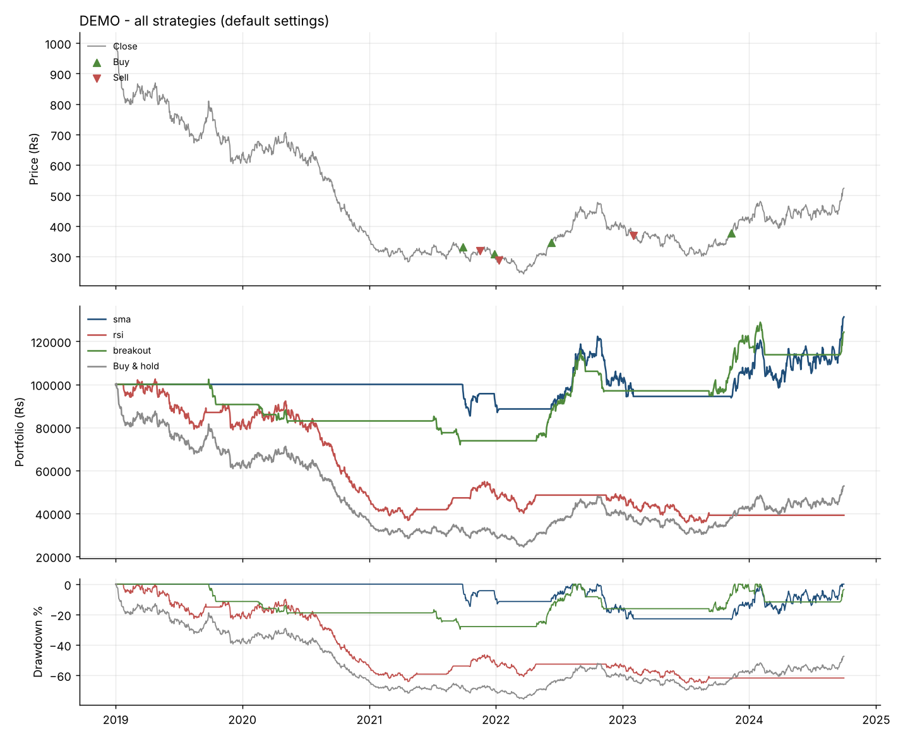

# nse-backtester

Test trading strategies on NSE stocks using historical data **before** risking real money in Zerodha.

You give it a stock and a strategy. It replays the past day by day, trades the way the rules say, charges realistic Indian taxes and fees, and tells you whether the strategy would have beaten simply buying and holding.



## Setup (once)

Requires Python 3.10+.

```bash
git clone https://github.com/Anankin77/nse-backtester.git
cd nse-backtester
python -m venv venv
# Windows:  venv\Scripts\activate      Linux/Mac:  source venv/bin/activate
pip install -r requirements.txt
```

Check that it works (offline, uses fake prices):

```bash
python run.py compare DEMO
```

## Web app (easiest)

```bash
./start.sh
```
Opens in your browser at http://localhost:8501, in a dark theme. It runs on your own computer with the same engine as the commands below, so results are identical. Pages stay empty until you press their button.

| Page (left sidebar) | What it does |
|---|---|
| **Home** | A plain start page with links to the three main tools |
| **Backtest** | One company, one strategy (with sliders to fine-tune it): yearly return, worst fall, an interactive chart with every buy and sell, and the trade log |
| **Compete** | Pick any companies (Nifty 50, your watchlist, or your own choice) and any of 7 strategies, including buy & hold as the benchmark. Every pair is ranked by Sharpe, return, Calmar, smallest fall, or edge over holding. **Fair test** picks winners on older data and checks them on newer data, so you can see which winners were luck |
| **Today's signals** | Current buy/sell signals for paper trading. Ignores the unfinished bar while the market is open |
| **Paper bot** | A fake account that trades itself every evening: tomorrow's orders, open positions, P&L against holding the index, reconciliation warnings, and a "ready for real money?" checklist |
| **Manual log** | A table for fake trades you type in yourself, saved to `paper_trades.csv`. The bot makes this optional |
| **Learn** | The learning path, one phase per expandable section |

Shared settings (dates, capital, costs, stop-loss, position size) sit in the sidebar under the menu and apply to every page. The sidebar also shows the date of the latest prices. For a quick look without internet, choose the company `DEMO` on the Backtest page.

## On your phone, with the laptop off

The same app can run on Streamlit Community Cloud (free), private to you.

How it fits together:

1. **Prices.** A GitHub Actions job (`.github/workflows/prices.yml`) downloads every stock in `watchlist.txt` and `nifty50.txt` from Yahoo at 4:37 pm and 6:37 pm IST on weekdays, and saves them in `prices/`. The app reads `prices/`, so it never has to reach Yahoo itself.
2. **App.** Streamlit Cloud runs `app.py` from this repo and updates itself whenever the repo changes, including after each day's prices.
3. **Paper log.** Saved in a separate private repo (`nse-paper-log`), so it survives app restarts and is the same on every device. This repo stays code and prices only.

### One-time setup (about 15 minutes)

**A. Private repo for the paper log**

1. GitHub > **New repository**. Name `nse-paper-log`, choose **Private**, tick **Add a README file**, create.
2. GitHub > your photo > **Settings** > **Developer settings** > **Personal access tokens** > **Fine-grained tokens** > **Generate new token**.
   - Name: `nse-paper-log`. Expiration: the longest offered.
   - Repository access: **Only select repositories** > `nse-paper-log`.
   - Permissions > Repository permissions > **Contents: Read and write**.
   - Generate, then copy the token (starts with `github_pat_`). GitHub shows it only once.

The token can only touch that one repo, and only lives in the app's secret settings, never in this repo.

**B. The hosted app**

1. Go to [share.streamlit.io](https://share.streamlit.io) and **Continue with GitHub** (as Anankin77).
2. **Create app** > deploy from GitHub: repository `Anankin77/nse-backtester`, branch `main`, main file `app.py`.
3. **Advanced settings**: Python 3.12. In **Secrets**, paste (with your token):
   ```toml
   [paper_log]
   repo = "Anankin77/nse-paper-log"
   token = "github_pat_..."
   ```
4. **Deploy**. The first start takes a few minutes.
5. Right away: the app's **Settings** > **Sharing** > **Only specific people can view this app**, and add your Gmail. Without this the app is public. (The free plan allows one private app.)
6. On your phone, open the app's link, sign in with Google, then **Add to Home Screen**.

**C. The paper bot's key**

The daily price job also runs the paper bot, which writes to the same private repo. Give the job the token:

1. GitHub > `nse-backtester` > **Settings** > **Secrets and variables** > **Actions** > **New repository secret**.
2. Name `PAPER_LOG_TOKEN`, value: the same `github_pat_...` token as above. Save.

Without this secret the bot step is skipped with a warning and everything else works as before.

**D. Laptop (optional).** To use the same paper log there, create `.streamlit/secrets.toml` with the same three lines. It's in `.gitignore`, so it never gets pushed. If you already have trades in `paper_trades.csv`, upload that file to `nse-paper-log` (Add file > Upload files).

### Day to day

- Prices update once a day. Before ~4:40 pm you see the previous trading day, which is fine: every signal acts at the next open.
- The app sleeps after 12 hours without visitors. Opening it then shows a wake-up button; it takes about a minute.
- To follow a new stock, add it to `watchlist.txt` (you can edit it on GitHub from your phone). That starts the price job; the stock appears a few minutes later.
- Run the price job by hand: GitHub > **Actions** > **Update prices** > **Run workflow**.
- If the job fails, GitHub emails you, and the sidebar warns when prices are more than 4 days old. A bad download never overwrites good saved prices.

## Command line

| Command | What it does |
|---|---|
| `python run.py compare RELIANCE` | All strategies vs buy & hold on Reliance |
| `python run.py test TCS --strategy sma --param fast=20 --param slow=100` | One strategy, your settings, full trade log |
| `python run.py optimize INFY --strategy rsi --split 2022-01-01` | Finds the best settings on pre-2022 data, then checks them on 2022+ data |
| `python run.py compare ^NSEI --start 2010-01-01` | Nifty 50 index |
| `python run.py test mydata.csv --strategy breakout` | Your own CSV (Date, Open, High, Low, Close, Volume) |
| `python run.py scan` | Every strategy on every stock in `watchlist.txt`: which ideas work where |
| `python run.py scan --list nifty50` | Same, across all 50 Nifty stocks, with a summary of how often each strategy wins |
| `python run.py compare SBIN --stop 10 --trailing` | Add a 10% trailing stop-loss to every strategy |
| `python run.py test TCS --strategy sma --stop 8 --risk 1` | Risk 1% of equity per trade with an 8% stop |
| `python run.py today` | Today's buy/sell signals for your watchlist, for paper trading |
| `python run.py update` | Refresh `prices/` from Yahoo. GitHub does this daily; you shouldn't need it |
| `python run.py paper --dir paper_log` | Run the paper bot once on your laptop, writing to a local folder (the daily job writes to the private repo) |
| `python run.py walkforward` | Momentum portfolio vs holding the Nifty, out-of-sample, at ₹4,000 and ₹1,00,000 (see below) |

**New to this? Start with the [learning path](docs/LEARNING.md).**

Common options: `--start 2015-01-01`, `--end 2024-12-31`, `--capital 50000`, `--no-costs`, `--no-plot`.

Tickers are plain NSE symbols (`HDFCBANK`, `SBIN`, `TMPV`); `.NS` is added for you. Prices for your watchlist and the Nifty 50 come from `prices/` (saved daily by GitHub, see above). Any other ticker is downloaded from Yahoo Finance and cached in `data/` for the day. Charts and trade logs go to `results/`.

## Stop-losses and position sizing

All values are percentages. They apply to the strategies; buy & hold always stays all-in as a clean benchmark.

| Option | What it does |
|---|---|
| `--stop 10` | Sell if price falls 10% below your entry. If the stock **gaps** below the stop at the open, you're filled at the open (worse), as in real life. |
| `--trailing` | The stop follows the highest close since entry, locking in gains. |
| `--size 50` | Put 50% of equity into each trade; the rest stays in cash. |
| `--vol-target 15` | Size each trade so it moves about 15%/yr: calm stocks get bigger positions, wild ones smaller. Uses the 20 days before entry. |
| `--risk 1` | Lose at most 1% of equity if the stop hits. Position = risk ÷ stop, so `--risk 1 --stop 10` invests 10%. Needs `--stop`. |

If you combine sizing options, the smallest position wins. After a stop-out, the strategy waits for its signal to turn off and back on before re-entering, so it won't instantly re-buy the same falling stock.

New columns: **Avg exposure %** (how much of your money was actually in the market on average), and **Stops hit**. The trade log shows each exit's reason: `signal`, `stop`, `stop (gap)` or `still open`.

## Portfolio mode and the walk-forward test

```bash
python run.py walkforward
```

One command answers: **does a strategy beat simply holding the Nifty 50, on data it never saw, with small money?**

| Part | How it works |
|---|---|
| Portfolio (`backtester/portfolio.py`) | One cash pool across many stocks. Whole shares only. Per-stock limit (`--max-weight`, default 40%) and total limit (`--max-exposure`, default 100%). Sells first, then buys, strongest stock first |
| Strategy (`backtester/momentum.py`) | Each month-end, rank `nifty50.txt` by past 6- and/or 12-month return, skipping the latest month. Hold the top N in equal amounts. All cash while `^NSEI` is below its 200-day average |
| Walk-forward (`backtester/walkforward.py`) | Train on 5 years (pick lookback 6m / 12m / both and N = 3 / 5 / 10 by CAGR), test on the next year, roll forward. Train from 2012, so test years are 2017 onward. Each test year starts fresh with the stated capital |
| Costs | Zerodha delivery charges, slippage, and ₹15.34 DP charge per stock per day it is sold |

Options: `--capital 4000 100000`, `--first-year 2012`, `--train-years 5`, `--list nifty50`, `--no-costs`.

### Result (prices to 2026-11-09, test years 2017 to 2026)

| | CAGR | Worst fall | Sharpe |
|---|---|---|---|
| Momentum, ₹4,000 | 11.9% | -37% | 0.36 |
| Momentum, ₹1,00,000 | 16.7% | -28% | 0.58 |
| Buy & hold `^NSEI` | 12.3% | -38% | 0.39 |
| Same 50 stocks, just held (control) | 22.6% | -38% | 0.92 |

**Verdict: no honest evidence that it beats the index.**

- **₹4,000: does not beat the index.** Trading costs eat about 5% of capital a year (the flat DP charge is 0.4% of the account per sale), and whole shares leave much of the money idle.
- **₹1,00,000: not proven.** It is 4.4 points a year ahead of `^NSEI` on paper, but it won only 5 of 10 test years, and simply holding the same 50 stocks did 5.9 points better than the strategy. The list is today's index, chosen with hindsight, and that hindsight alone is worth about 10 points a year here. The strategy adds nothing on top of it.

What the result still leaves out, all in the strategy's favour or the index's disfavour as noted:

- **Survivorship bias** (above): the biggest problem. A fair test needs the index's members as they were each year.
- `^NSEI` excludes dividends (about 1.2% a year); stock prices include them. The report shows the edge after this.
- Whole shares are sized on adjusted prices, which are lower than what a share really cost before a split or bonus.
- No capital-gains tax. Monthly selling pays 20% short-term tax every year; holding the index defers it.
- The index is treated as buyable in any amount with no fund fee.

## Paper bot

A fake account that trades itself, so paper trading costs you no effort and can't be fudged.

**How it runs**

1. You set the rules once in `paper.toml`: stocks, strategy, capital, risk limits.
2. Every weekday evening the price job saves the day's prices, then runs the bot (`backtester/paper.py`).
3. The bot fills yesterday's decisions at today's open, with full costs, and works out tomorrow's orders.
4. Results go to the `bot/` folder of your private `nse-paper-log` repo and show on the **Paper bot** page.

**Rules in `paper.toml`**

| Setting | Meaning |
|---|---|
| `capital`, `start`, `benchmark` | Account size, first trading day, and the index it is measured against |
| `strategy` | `momentum` (monthly, top N) or `sma` / `rsi` / `breakout` (one signal per stock, equal slots) |
| `per_stock`, `total` | Most of the account allowed in one stock, and in stocks altogether (%) |
| `max_drawdown` | Kill switch: this far below its peak, the bot sells everything at the next open and stops. Set `resume = "YYYY-MM-DD"` to restart |
| `min_order` | Skip buys and trims smaller than this many rupees: the flat DP charge makes them pointless |
| `band` | How far a held stock may drift from its target before it is resized (%) |

One cash pool is shared by all stocks. Whole shares only. Changing a rule takes effect the next day; past fills are never rewritten.

**Files in `nse-paper-log/bot/`**

| File | What it holds |
|---|---|
| `ledger.csv` | Every fill, dividend and split. Rows are only ever added |
| `equity.csv` | One row per day: account value, cash, and the index held instead |
| `positions.csv` | What is held now, with average cost and P&L |
| `warnings.csv` | Every price-check and reconciliation warning. Rows are only ever added |
| `state.json` | Where the bot got to, and the orders for the next open |
| `snapshot.csv` | Yesterday's copy of recent prices, for the price check |

**The two daily checks**

1. **Price check.** Today's saved prices are compared with yesterday's copy, for every stock in the list.
   - Whole history moved by one factor: a dividend or split. The account gets the dividend in cash or the new share count. No warning.
   - Anything else: Yahoo revised the past, or a bad tick. Warning.
2. **Reconciliation.** The backtester is re-run over the paper period with today's prices and compared with the ledger, fill by fill and day by day. Any difference is a warning: revised prices, data that arrived late, or a logic bug. Each problem is reported once; the check then carries on from that day.

The bot fills at the prices of the day, not at prices adjusted backwards later, which is why the ledger never needs rewriting.

**Ready for real money?** The page ends with a checklist. All five must pass:

1. At least 6 months of live paper trading. Days filled in from history when the account was set up don't count: that is a backtest.
2. Ahead of holding the index after costs, by more than the index's dividends (about 1.2% a year).
3. Worst fall no deeper than the index's.
4. Kill switch never tripped.
5. No price or reconciliation warnings in the last 30 days.

Until then, the honest default for real money is an index fund: the walk-forward test below found no proof that the default strategy beats it. Live paper trading has one advantage over that backtest: going forward, today's stock list carries no hindsight.

Not modelled: stop-losses per position (the single-stock engine has them, portfolio mode does not), capital-gains tax, and interest on idle cash.

## Strategies

| Name | Type | Rule | Settings (default) |
|---|---|---|---|
| `buyhold` | Benchmark | Buy on day 1, never sell | — |
| `sma` | Trend following | Hold while the fast moving average is above the slow one ("golden cross") | `fast=50`, `slow=200` |
| `rsi` | Mean reversion | Buy when RSI says oversold, sell when overbought | `period=14`, `buy_below=30`, `sell_above=70` |
| `breakout` | Momentum (Turtle/Donchian) | Buy a new N-day high, sell a new M-day low | `lookback=55`, `exit_lookback=20` |

Add your own in `backtester/strategies.py`: write a function that returns 1 (invested) or 0 (cash) for each day, then add it to `STRATEGIES`.

## Reading the results

| Metric | Meaning | Rough "good" |
|---|---|---|
| CAGR % | Average yearly growth | Beats buy & hold and FD (~7%) |
| Max drawdown % | Worst fall from a peak. Can you stomach this in real life? | Smaller than buy & hold |
| Sharpe | Return per unit of risk, above the risk-free rate (6.5% assumed) | > 0.5 ok, > 1 good |
| Sortino | Like Sharpe, but only counts downside swings | Higher is better |
| Calmar | CAGR ÷ max drawdown | > 0.5 |
| Win rate % | Share of closed trades that made money | Trend strategies are often 30–40% and still profit |
| Time in market % | How often you are invested | Lower = less risk, more idle cash |

## How it stays honest

1. **No look-ahead bias.** A signal decided at today's close is filled at tomorrow's open. The strategy never sees the future.
2. **Real costs.** Zerodha delivery rates (checked Oct 2026): STT 0.1% each side, exchange + SEBI fees, stamp duty on buys, GST, plus 0.05% slippage per side (`backtester/costs.py`), and the flat DP charge (₹15.34 per stock per day it is sold). Capital-gains tax is not included, so frequent traders look better than reality.
3. **Overfitting check.** `optimize` tunes on old data and reports performance on newer, unseen data. If the test result collapses, the "best" settings were luck.
4. **Conservative stops.** Gaps fill at the open, not the stop price. Trailing stops trail closes, not intraday highs, because daily data can't tell whether the high came before the low.
5. **Tested.** 80 `pytest` checks cover the timing rule, costs, stop fills (normal, gap, trailing, re-entry), each sizing method, trade-by-trade returns reconciling with the equity curve, the competition, whole-share portfolio fills, DP charges, rebalancing, momentum ranking, the walk-forward windows, the paper bot (day-by-day equals one long backtest, the ledger only grows, kill switch, dividends and splits, revised prices are flagged), the price job (a bad download never replaces saved prices) and the paper log's private repo (saving from two devices is caught, not overwritten).

## Limits (read before trading real money)

- Long-only. `test`, `compare` and `scan` trade one stock at a time; `walkforward` and the paper bot run a combined portfolio.
- **Survivorship bias:** `nifty50.txt` holds today's members, so stocks that crashed out of the index are missing and results look better than reality.
- Daily data only, so no intraday strategies. Saved prices refresh once a day, after the close.
- Cash earns 0% while out of the market (in reality you'd park it in a liquid fund).
- Yahoo data is free but occasionally has gaps or bad ticks.
- A good backtest is necessary, not sufficient. Let the paper bot run a strategy for at least six months before using real money.

## Project layout

```
app.py                   web app (streamlit)
start.sh                 one-command launcher
run.py                   command-line interface
prices/                  daily prices, saved by GitHub (don't edit)
.github/workflows/       the daily price job
backtester/
  analysis.py            scan rows, summaries, today's signals (shared by app and CLI)
  data.py                saved prices / download / cache / CSV / synthetic prices
  update.py              the daily price download
  github_file.py         paper log in a private GitHub repo
  strategies.py          indicators + strategy rules
  portfolio.py           portfolio simulation (shared cash, whole shares, limits)
  momentum.py            monthly momentum ranking + market filter
  walkforward.py         rolling train/test windows, report, verdict
  paper.py               the paper bot: daily fills, ledger, price check, reconciliation
  engine.py              the simulation (timing, costs, trade log)
  costs.py               Indian delivery charges
  metrics.py             CAGR, Sharpe, drawdown, ...
  plotting.py            charts
tests/                   pytest suite
paper.toml               the paper bot's rules
watchlist.txt            your stocks for scan / today
nifty50.txt              Nifty 50 members (after the Sep 30, 2026 rebalance)
docs/LEARNING.md         learning path
```

## Possible next steps

- Survivorship-bias-free data (include stocks that left the Nifty)
