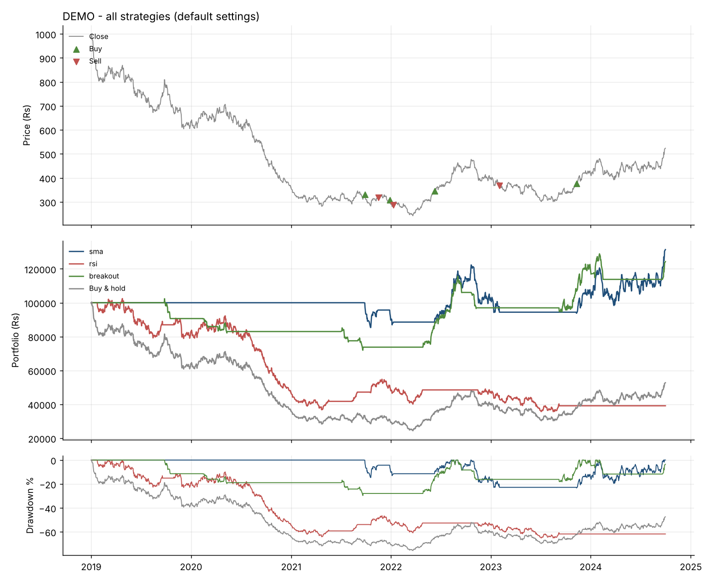

# nse-backtester

Test trading strategies on NSE stocks using historical data **before** risking real money in Zerodha.

You give it a stock and a strategy. It replays the past day by day, trades the way the rules say, charges realistic Indian taxes and fees, and tells you whether the strategy would have beaten simply buying and holding.



## Setup (once)

Requires Python 3.10+.

```bash
git clone https://github.com/Anankin77/nse-backtester.git
cd nse-backtester
python -m venv venv
# Windows:  venv\Scripts\activate      Linux/Mac:  source venv/bin/activate
pip install -r requirements.txt
```

Check that it works (offline, uses fake prices):

```bash
python run.py compare DEMO
```

## Usage

| Command | What it does |
|---|---|
| `python run.py compare RELIANCE` | All strategies vs buy & hold on Reliance |
| `python run.py test TCS --strategy sma --param fast=20 --param slow=100` | One strategy, your settings, full trade log |
| `python run.py optimize INFY --strategy rsi --split 2022-01-01` | Finds the best settings on pre-2022 data, then checks them on 2022+ data |
| `python run.py compare ^NSEI --start 2010-01-01` | Nifty 50 index |
| `python run.py test mydata.csv --strategy breakout` | Your own CSV (Date, Open, High, Low, Close, Volume) |
| `python run.py scan` | Every strategy on every stock in `watchlist.txt`: which ideas work where |
| `python run.py scan --list nifty50` | Same, across all 50 Nifty stocks, with a summary of how often each strategy wins |
| `python run.py compare SBIN --stop 10 --trailing` | Add a 10% trailing stop-loss to every strategy |
| `python run.py test TCS --strategy sma --stop 8 --risk 1` | Risk 1% of equity per trade with an 8% stop |
| `python run.py today` | Today's buy/sell signals for your watchlist, for paper trading (run after 3:30 pm) |

**New to this? Start with the [learning path](docs/LEARNING.md).**

Common options: `--start 2015-01-01`, `--end 2024-12-31`, `--capital 50000`, `--no-costs`, `--no-plot`.

Tickers are plain NSE symbols (`HDFCBANK`, `SBIN`, `TMPV`); `.NS` is added for you. Data comes from Yahoo Finance and is cached in `data/` for the day, so rerunning a scan is instant. Charts and trade logs go to `results/`.

## Stop-losses and position sizing

All values are percentages. They apply to the strategies; buy & hold always stays all-in as a clean benchmark.

| Option | What it does |
|---|---|
| `--stop 10` | Sell if price falls 10% below your entry. If the stock **gaps** below the stop at the open, you're filled at the open (worse), as in real life. |
| `--trailing` | The stop follows the highest close since entry, locking in gains. |
| `--size 50` | Put 50% of equity into each trade; the rest stays in cash. |
| `--vol-target 15` | Size each trade so it moves about 15%/yr: calm stocks get bigger positions, wild ones smaller. Uses the 20 days before entry. |
| `--risk 1` | Lose at most 1% of equity if the stop hits. Position = risk ÷ stop, so `--risk 1 --stop 10` invests 10%. Needs `--stop`. |

If you combine sizing options, the smallest position wins. After a stop-out, the strategy waits for its signal to turn off and back on before re-entering, so it won't instantly re-buy the same falling stock.

New columns: **Avg exposure %** (how much of your money was actually in the market on average), and **Stops hit**. The trade log shows each exit's reason: `signal`, `stop`, `stop (gap)` or `still open`.

## Strategies

| Name | Type | Rule | Settings (default) |
|---|---|---|---|
| `buyhold` | Benchmark | Buy on day 1, never sell | — |
| `sma` | Trend following | Hold while the fast moving average is above the slow one ("golden cross") | `fast=50`, `slow=200` |
| `rsi` | Mean reversion | Buy when RSI says oversold, sell when overbought | `period=14`, `buy_below=30`, `sell_above=70` |
| `breakout` | Momentum (Turtle/Donchian) | Buy a new N-day high, sell a new M-day low | `lookback=55`, `exit_lookback=20` |

Add your own in `backtester/strategies.py`: write a function that returns 1 (invested) or 0 (cash) for each day, then add it to `STRATEGIES`.

## Reading the results

| Metric | Meaning | Rough "good" |
|---|---|---|
| CAGR % | Average yearly growth | Beats buy & hold and FD (~7%) |
| Max drawdown % | Worst fall from a peak. Can you stomach this in real life? | Smaller than buy & hold |
| Sharpe | Return per unit of risk, above the risk-free rate (6.5% assumed) | > 0.5 ok, > 1 good |
| Sortino | Like Sharpe, but only counts downside swings | Higher is better |
| Calmar | CAGR ÷ max drawdown | > 0.5 |
| Win rate % | Share of closed trades that made money | Trend strategies are often 30–40% and still profit |
| Time in market % | How often you are invested | Lower = less risk, more idle cash |

## How it stays honest

1. **No look-ahead bias.** A signal decided at today's close is filled at tomorrow's open. The strategy never sees the future.
2. **Real costs.** Zerodha delivery rates (checked Oct 2026): STT 0.1% each side, exchange + SEBI fees, stamp duty on buys, GST, plus 0.05% slippage per side (`backtester/costs.py`). The flat DP charge (₹15.34 per sell) and capital-gains tax are not included, so small orders and frequent traders look better than reality.
3. **Overfitting check.** `optimize` tunes on old data and reports performance on newer, unseen data. If the test result collapses, the "best" settings were luck.
4. **Conservative stops.** Gaps fill at the open, not the stop price. Trailing stops trail closes, not intraday highs, because daily data can't tell whether the high came before the low.
5. **Tested.** 17 `pytest` checks cover the timing rule, costs, stop fills (normal, gap, trailing, re-entry), each sizing method, and that trade-by-trade returns reconcile with the equity curve.

## Limits (read before trading real money)

- Long-only, one stock at a time. `scan` tests stocks separately; it doesn't run a combined portfolio.
- **Survivorship bias:** `nifty50.txt` holds today's members, so stocks that crashed out of the index are missing and results look better than reality.
- Daily data only, so no intraday strategies.
- Cash earns 0% while out of the market (in reality you'd park it in a liquid fund).
- Yahoo data is free but occasionally has gaps or bad ticks.
- A good backtest is necessary, not sufficient. Paper trade a strategy for a few months before using real money.

## Project layout

```
run.py                   command-line interface
backtester/
  data.py                download / cache / CSV / synthetic prices
  strategies.py          indicators + strategy rules
  engine.py              the simulation (timing, costs, trade log)
  costs.py               Indian delivery charges
  metrics.py             CAGR, Sharpe, drawdown, ...
  plotting.py            charts
tests/                   pytest suite
watchlist.txt            your stocks for scan / today
nifty50.txt              Nifty 50 members (after the Sep 30, 2026 rebalance)
docs/LEARNING.md         learning path
```

## Possible next steps

- Portfolio mode: one pool of cash shared across many stocks
- Walk-forward optimisation (repeat the train/test split over rolling windows)
- Survivorship-bias-free data (include stocks that left the Nifty)
